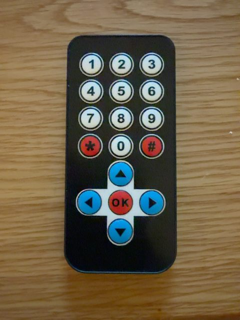

# Electrokit IR Remote for micro:bit

A Microsoft MakeCode extension for the **17-button Electrokit infrared remote** with number keys at the top and navigation keys at the bottom. Tested with **BBC micro:bit V2**.



## Features

- Correct mapping for all 17 physical buttons (`0–9`, `*`, `#`, `Up`, `Down`, `Left`, `Right`, `OK`)
- NEC IR decoding without a dependency on MakerBit
- `onButtonPressed`, `isHeld`, and `onButtonReleased` (estimated)
- Configurable release timeout (100–1000 ms; default 300 ms)
- Last received command and full hexadecimal NEC frame

## Install

In [MakeCode for micro:bit](https://makecode.microbit.org/), create a project, select **Extensions**, and paste:

`https://github.com/raza-ui677/electrokit-ir-remote`

Connect the IR receiver signal to **P0**, power to the receiver's specified supply voltage, and ground to **GND**.

## Example

```typescript
electrokitIR.connect(DigitalPin.P0)
electrokitIR.setReleaseTimeout(350)

electrokitIR.onButtonPressed(ElectrokitButton.OK, function () {
    basic.showIcon(IconNames.Heart)
})
electrokitIR.onButtonReleased(ElectrokitButton.OK, function () {
    basic.clearScreen()
})

basic.forever(function () {
    if (electrokitIR.isHeld(ElectrokitButton.Up)) {
        led.plot(2, 0)
    } else {
        led.unplot(2, 0)
    }
    basic.pause(30)
})
```

## Important notes

- NEC remotes do **not** send a separate release signal. Release is **estimated** when repeat frames stop arriving.
- Do not rely on infrared reception alone for safety-critical motor stopping or emergency stops.
- Only connect **one** IR decoder to the receiver pin in a MakeCode project.
- Tested by the project owner: 17 unique button codes received; Up remains held during a sustained press and becomes unheld after release. The final packaged release has not yet been independently compiled or re-tested.

## License

MIT. See [LICENSE](LICENSE).
